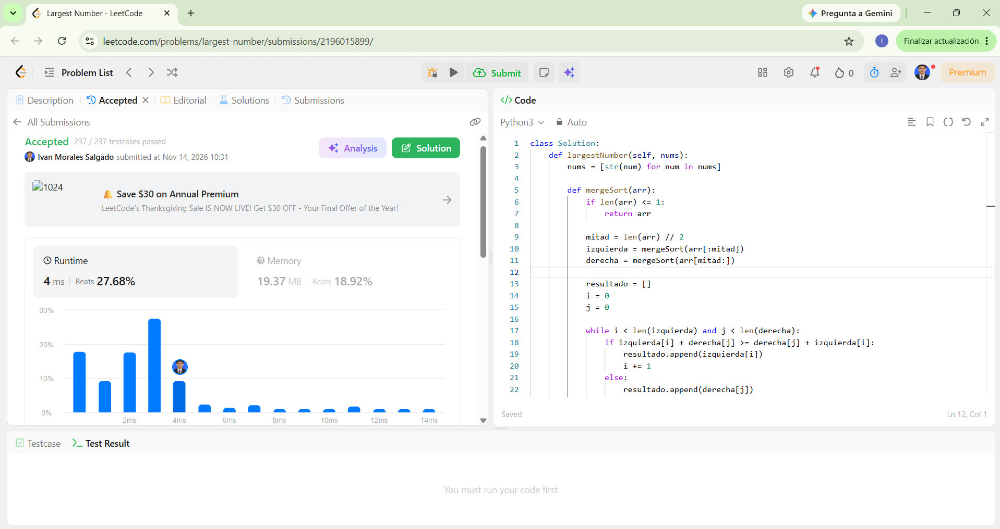

# Taller Final - Análisis de Algoritmos

## Integrantes

| Integrante | Usuario de GitHub | Ejercicios |
| --- | --- | --- |
| Ivan Morales Salgado | ivnmorales | 215, 179 |

## 215. Kth Largest Element in an Array

Problema: https://leetcode.com/problems/kth-largest-element-in-an-array/

Autor: Ivan Morales Salgado(ivnmorales)

Familia: Heap

Idea: Utilice un min-heap que guarda los k números más grandes del arreglo. Voy recorriendo los números y si encuentro uno mayor que el más pequeño del heap lo reemplazo. Al final el primer elemento del heap es el k-ésimo número más grande.

Complejidad:

Tiempo: O(n log k), porque se recorren los n elementos y las operaciones del heap pueden tomar O(log k).

Espacio: O(k), porque el heap guarda como máximo k elementos.

## 179. Largest Number

Problema: https://leetcode.com/problems/largest-number/

Autor: Ivan Morales Salgado(ivnmorales)

Familia: Ordenamiento

Idea: Utilice Merge Sort para ordenar los números pero primero los convertí en cadenas de texto. Para saber cuál debe ir primero comparo las dos formas de unirlos. Por ejemplo, entre 10 y 2, comparo 102 y 210, y dejo primero el 2 porque así se forma un número mayor. Al final uno todos los números en una sola cadena.

Complejidad:

Tiempo: O(n log n) comparaciones, porque se utiliza Merge Sort. Cada comparación también depende de la cantidad de dígitos de los números.

Espacio: O(n), porque se crean arreglos auxiliares durante el ordenamiento, considerando que cada número tiene una cantidad limitada de dígitos.

