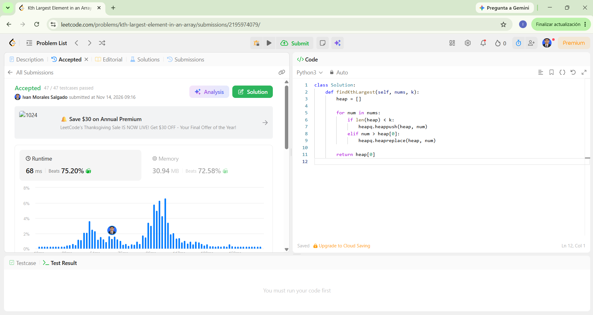
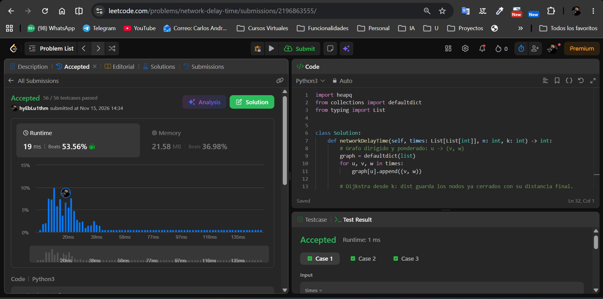
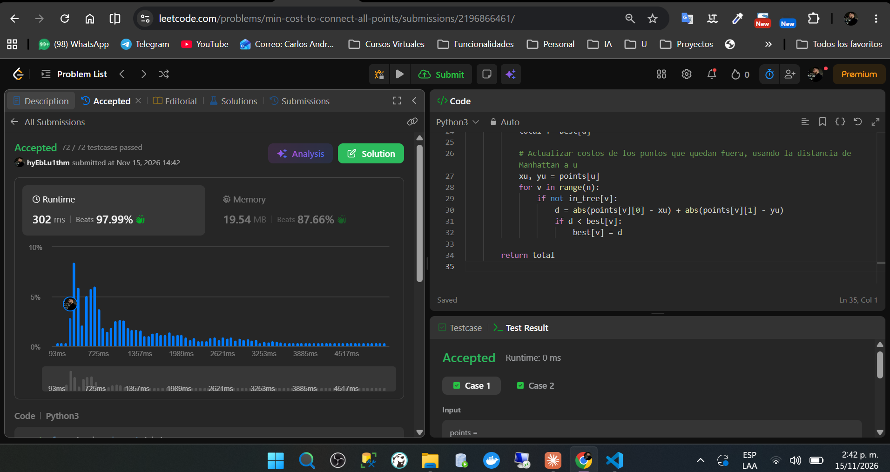

# Taller Final - Análisis de Algoritmos

## Integrantes

| Integrante | Usuario de GitHub | Ejercicios |
| --- | --- | --- |
| Ivan Morales Salgado | ivnmorales | 215, 179 |
| Carlos Andres Arteaga | caarteagag | 743, 1584 |

## 215. Kth Largest Element in an Array

Problema: https://leetcode.com/problems/kth-largest-element-in-an-array/

Autor: Ivan Morales Salgado(ivnmorales)

Familia: Heap

Idea: Utilice un min-heap que guarda los k números más grandes del arreglo. Voy recorriendo los números y si encuentro uno mayor que el más pequeño del heap lo reemplazo. Al final el primer elemento del heap es el k-ésimo número más grande.

Complejidad:

Tiempo: O(n log k), porque se recorren los n elementos y las operaciones del heap pueden tomar O(log k).

Espacio: O(k), porque el heap guarda como máximo k elementos.

## 179. Largest Number

Problema: https://leetcode.com/problems/largest-number/

Autor: Ivan Morales Salgado(ivnmorales)

Familia: Ordenamiento

Idea: Utilice Merge Sort para ordenar los números pero primero los convertí en cadenas de texto. Para saber cuál debe ir primero comparo las dos formas de unirlos. Por ejemplo, entre 10 y 2, comparo 102 y 210, y dejo primero el 2 porque así se forma un número mayor. Al final uno todos los números en una sola cadena.

Complejidad:

Tiempo: O(n log n) comparaciones, porque se utiliza Merge Sort. Cada comparación también depende de la cantidad de dígitos de los números.

Espacio: O(n), porque se crean arreglos auxiliares durante el ordenamiento, considerando que cada número tiene una cantidad limitada de dígitos.

## 743. Network Delay Time

Problema: https://leetcode.com/problems/network-delay-time/

Autor: Carlos Andres Arteaga (`caarteagag`)

Familia: Grafos (Dijkstra)

Idea: Modelé la red como un grafo dirigido y ponderado (cada arco u → v tiene peso w). Desde el nodo k corro Dijkstra con un min-heap de distancias tentativas: siempre saco el nodo con menor tiempo acumulado, lo cierro y relajo sus arcos. Si algún nodo nunca se cierra, la señal no llega a todos y devuelvo -1; si todos se cierran, la respuesta es la mayor distancia final, porque hay que esperar al nodo que más tarda.

Complejidad:

Tiempo: O((n + m) log n), con n nodos y m = `times.length` arcos. Cada arco puede generar una entrada en el heap, y cada operación del heap cuesta O(log m), que es O(log n) porque m ≤ n².

Espacio: O(n + m), por el grafo de adyacencia, el heap y el diccionario de distancias.

## 1584. Min Cost to Connect All Points

Problema: https://leetcode.com/problems/min-cost-to-connect-all-points/

Autor: Carlos Andres Arteaga (`caarteagag`)

Familia: Grafos (árbol de recubrimiento mínimo)

Idea: Usé Prim sobre el grafo completo, donde el costo de unir dos puntos es la distancia de Manhattan. Empiezo el árbol en el punto 0 y guardo para cada punto fuera del árbol el costo mínimo de conectarlo. En cada paso elijo el punto fuera del árbol con menor costo, lo agrego (sumando ese costo) y actualizo los costos de los demás puntos con la distancia al nuevo punto. Al final la suma es el costo mínimo para conectar todos.

Complejidad:

Tiempo: O(n²), con n = `points.length`. Como el grafo es completo (Θ(n²) aristas), en cada uno de los n pasos se recorren los n puntos para buscar el mínimo y actualizar costos.

Espacio: O(n), por los arreglos de costos y de puntos dentro del árbol.

